  

### Hi, I'm Iñaki

I'm a software engineer in Bilbao with 8+ years of experience. For the last 7 I've built **payments, invoicing and fraud-prevention systems** for Lookiero & Outfittery, a subscription fashion company that operates across Europe.

I'm backend-focused (Java, Spring Boot, event-driven microservices) and comfortable on the frontend with React and React Native. Before that, I programmed a PlayStation 4 game.

**What I've been working on**

- Integrating payment providers: Stripe, Klarna, iDeal and PayPal, on web, iOS and Android
- Multi-currency payments and invoicing for launches in new markets
- Moving a legacy Vert.x/Groovy monolith to event-driven microservices step by step
- Fraud prevention, automatic invoicing and data pipelines into Databricks
- AI-assisted development with Claude Code and coding agents

**Tech I use**

**Side quests**

- [android-package-uninstaller](https://github.com/Queky/android-package-uninstaller): Python tool that removes Android packages over ADB
- [PythonAI](https://github.com/Queky/PythonAI): computer-vision experiments with OpenCV
- [advent-code-2020](https://github.com/Queky/advent-code-2020): Advent of Code 2020 solutions in Python

**Off the keyboard:** video games, Android tinkering, and science-fiction books.

**Find me:** [queky.es](https://queky.es)
